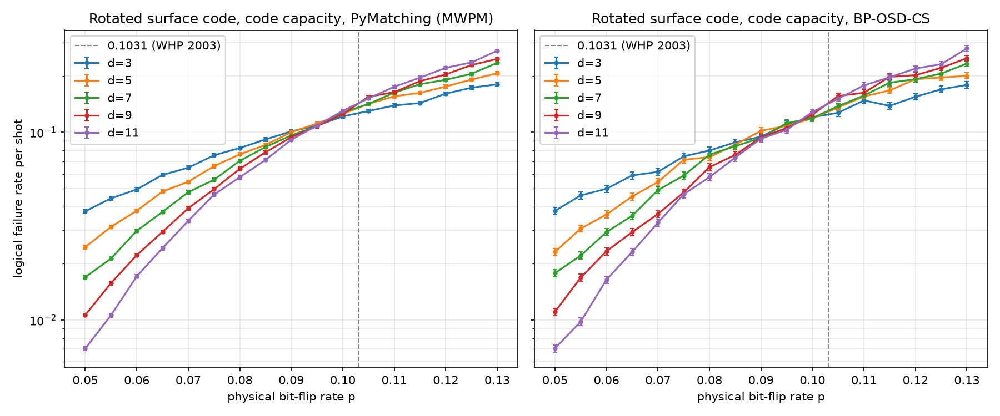
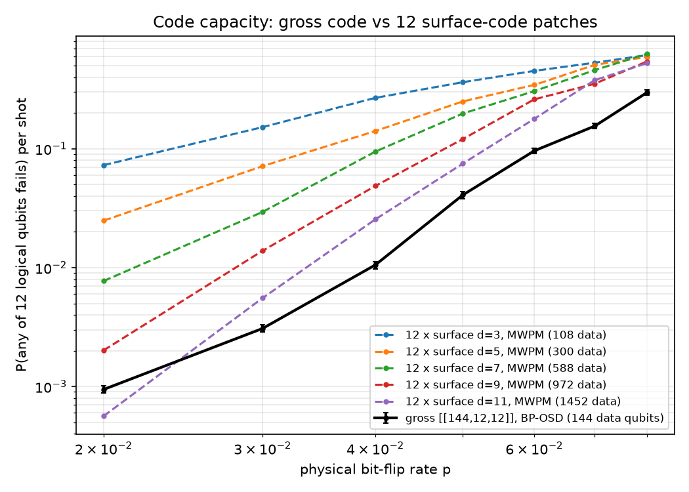
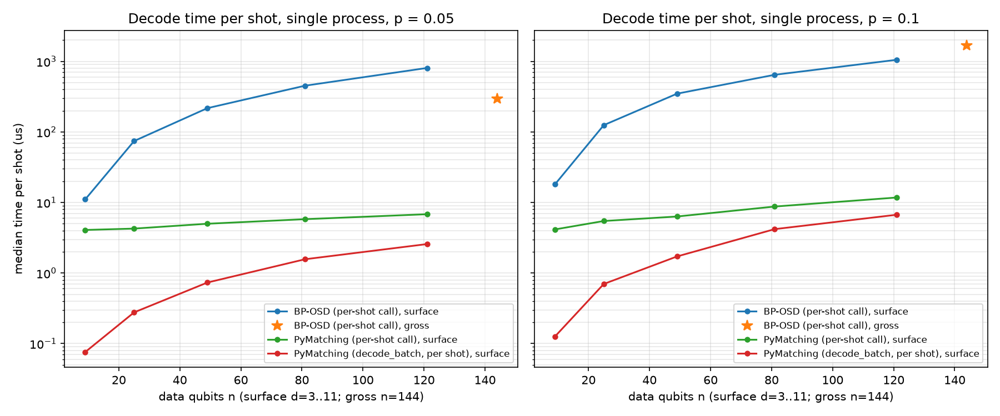

# qec-decoder-bench

[](https://github.com/VedantMahadik-qc/qec-decoder-bench/actions/workflows/tests.yml)

A benchmark of quantum error-correction decoders, built on [Stim](https://github.com/quantumlib/Stim)
(circuits and detector error models), [PyMatching](https://github.com/oscarhiggott/PyMatching)
(minimum-weight perfect matching), BP-OSD from [`ldpc`](https://github.com/quantumgizmos/ldpc), and
sinter (parallel Monte Carlo). It covers the rotated surface code under circuit-level noise
(Phase 1), and BP-OSD and the [[144,12,12]] bivariate bicycle ("gross") code under code-capacity
noise (Phase 2). Every result is checked against an analytic limit or a cited reference value, with
acceptance criteria fixed before the sweep ran.

**Key results**

- **Circuit-level surface-code threshold.** With the settings of Stim's getting-started notebook
  (rounds = 3d), the d = 5 / d = 7 per-round crossing is **1.055%** (bootstrap 95% [1.025%, 1.103%]),
  matching its "roughly 1%". Running rounds = d instead shifts the crossing to **1.168%**
  [1.082%, 1.237%], a time-boundary effect. [Details](#phase-1-rotated-surface-code-memory-experiment)
- **Code-capacity MWPM threshold.** The d = 9 / 11 crossing is **9.41%** [8.81%, 10.17%]. It passes
  the pre-registered 9–11% band but sits slightly below the 10.31% random-bond Ising reference
  (Wang, Harrington & Preskill 2003). [Details](#experiment-1-surface-code-code-capacity-threshold)
- **Gross code vs 12 surface patches.** At p = 2% under code capacity, one gross code matches 12
  surface patches of distance d* ≈ 10.2, with **~8.6–8.7× fewer qubits** (288 vs 2,480 total). This is
  code capacity only, not a reproduction of Bravyi et al.'s circuit-level result.
  [Details](#experiment-2-gross-code-vs-12-surface-code-copies)
- **BP-OSD vs PyMatching.** On the surface code, BP-OSD is about as accurate as MWPM on identical
  syndromes, but about **120× slower** per call at d = 11 (807 µs vs 6.8 µs).
  [Details](#experiment-3-decoder-timing)

## Quickstart

```bash
pip install -e ".[dev]"

# One circuit-level point: rotated surface code, Stim + PyMatching
qec-bench surface --d 5 --p 0.001 --rounds 15 --shots 100000

# One code-capacity point: gross code with BP-OSD (or --code surface --d 5 --decoder mwpm)
qec-bench codecap --code gross --p 0.05 --decoder bposd --shots 10000

# Rebuild every README plot and number from the committed CSVs (no re-simulation)
qec-bench reproduce phase2        # or phase1; writes to results/reproduced/
```

Tests: `pytest -m "not slow"` (fast suite, run in CI on Python 3.11 and 3.12). Plain `pytest`
also runs the Monte Carlo-heavy tests. Lint: `ruff check . && ruff format --check .`.

### Re-running the sweeps

All sweep CSVs are committed, so you can regenerate the plots and the validation numbers without
re-running the sweeps. sinter resumes from an existing CSV instead of starting over.

```bash
python scripts/run_surface_sweep.py --sweep main          # -> results/surface_sweep.csv
python scripts/run_surface_sweep.py --sweep replication   # -> results/notebook_replication.csv
python scripts/run_surface_sweep.py --sweep followup      # -> results/rounds_d_followup.csv
python scripts/plot_surface_sweep.py results/surface_sweep.csv
python scripts/plot_surface_sweep.py results/notebook_replication.csv

# Phase 2 (code capacity). --smoke does a short timed run to results/scratch/ and prints an estimate.
python scripts/run_code_capacity.py --exp threshold [--smoke]   # -> results/cc_surface_threshold.csv
python scripts/run_code_capacity.py --exp gross [--smoke]       # -> results/cc_gross_vs_surface.csv
python scripts/run_code_capacity.py --exp timing                # -> results/decoder_timing.csv
python scripts/analyze_code_capacity.py threshold               # crossings + pre-registered check
python scripts/analyze_code_capacity.py gross                   # matched d* and qubit counts
python scripts/plot_code_capacity.py threshold                  # also: gross, timing
```

## Results

- [Phase 1: rotated surface code memory experiment](#phase-1-rotated-surface-code-memory-experiment)
  (circuit-level noise, PyMatching): validation checks, threshold crossing, and the rounds = d
  follow-up.
- [Phase 2: BP-OSD and the [[144,12,12]] gross code](#phase-2-bp-osd-and-the-1441212-gross-code-code-capacity-noise)
  (code-capacity noise): code construction checks, the surface-code threshold, gross vs 12 surface
  patches, and decoder timing.

Where the numbers come from: the "Validation checks" tables report what the tests in `tests/`
measure. Everything else is computed from the committed CSVs in `results/`, and
`qec-bench reproduce` regenerates it. `tests/test_cli.py` checks the quoted values against that
output. The one exception is the BP convergence fractions in Experiment 3, which came from a
separate measurement.

## Phase 1: rotated surface code memory experiment

**Setup.** `surface_code:rotated_memory_z` from Stim with uniform circuit-level depolarizing noise:
`after_clifford_depolarization`, `before_round_data_depolarization`,
`before_measure_flip_probability` and `after_reset_flip_probability` are all set to p. Decoding is
PyMatching via sinter, with d ∈ {3, 5, 7}.

**Reference.** Stim's [`doc/getting_started.ipynb`](https://github.com/quantumlib/Stim/blob/main/doc/getting_started.ipynb),
section 9, uses this same noise model with rounds = 3d and p ∈ {0.008, …, 0.012}. It plots the
logical error rate per round and gives the threshold as "roughly 1%".

**Pre-registered acceptance criterion** (fixed before any sweep ran): the per-round crossing
between the d=5 and d=7 curves must fall in **0.7%–1.1%**.

### Validation checks (tests)

| Check | Type | Result |
|---|---|---|
| p = 0 → no detection events, no logical errors (d=3, 5) | analytic limit | pass |
| `shortest_graphlike_error()` length = d (d=3, 5, 7) | known value | pass |
| p = 0.3 → p_L ≈ 1/2 (d=3, 20k shots, ±4σ) | analytic limit | pass (0.498) |
| p = 2e-3: p_L(d=5) < p_L(d=3), >3σ separated | below-threshold behaviour | pass (1.05e-3 vs 2.97e-3) |

Low-p slopes of log p_L vs log p (main sweep, p ≤ 0.004; reported only, not pass/fail) come out as
1.93, 2.94 and 4.07 for d = 3, 5, 7, against ⌈d/2⌉ = 2, 3, 4.

## Findings

### Threshold crossing: the main sweep missed the band; the notebook replication is inside it

| Sweep | Rounds | Errors / point | (5,7) per-round crossing | Bootstrap 95% interval | p where d=5, d=7 agree within 2σ | Criterion |
|---|---|---|---|---|---|---|
| main | d | ~1,000 | **1.30%** | [0.98%, 1.42%] (median 1.08%; no crossing in 5% of replicates) | 1.0, 1.1, 1.11, 1.2, 1.5% | **fail** |
| replication | 3d | ~5,000+ | **1.055%** | [1.025%, 1.103%] | 1.1, 1.2% | pass |

How the crossing is computed: interpolate log(p_L,7 / p_L,5) linearly in log p and take the first
sign change. The uncertainty comes from a parametric bootstrap, which redraws each point's error
count from Binomial(shots, errors/shots) 2,000 times and re-runs the same estimator.


(The shaded bands are sinter's likelihood-ratio intervals, which are wider than 2σ.)

**What the data shows:**

1. **With the notebook's settings, we reproduce its threshold.** The replication crossing, 1.055%
   [1.025%, 1.103%], is consistent with "roughly 1%".

2. **The main sweep's crossing is poorly determined, and its point estimate misses the band.**
   Between p = 1.0% and 1.5%, the d=5 and d=7 per-round curves are within 2σ of each other at
   almost every sampled p. With only ~1,000 errors per point (~±3%), the sign-change estimator
   jumps around: the point estimate is 1.30%, but the bootstrap median is 1.08%, and the 95%
   interval spans 0.98%–1.42%. Part of this fragility comes from the p grid itself. Merging the
   log-spaced and linear grids produced near-duplicate points (0.011 and 0.0111, 0.008 and
   0.00822), and neighbours only ~1% apart in p let noise create spurious sign changes. The
   criterion was set on the point estimate, so the main sweep fails it. That result stands.

3. **Per-round rates depend on the number of rounds, and the dependence differs by distance.**
   Comparing the same (d, p) between the two sweeps:

   | d | per-round p_L (rounds = d) / (rounds = 3d), p = 0.008–0.012 | z-scores |
   |---|---|---|
   | 3 | 1.01–1.13 (higher with fewer rounds) | −0.2 to −3.4 |
   | 5 | 0.92–1.00 | 0.0 to 2.3 |
   | 7 | 0.87–0.94 (lower with fewer rounds, all 5 points) | 1.6 to 4.2 |

   The per-round conversion, p_round = (1 − (1 − 2 p_shot)^(1/r)) / 2, assumes every round
   contributes the same, independent flip probability. Time boundaries break that assumption.
   The first round's detectors compare against deterministic resets, and the final round uses
   data-qubit measurements, so these rounds have a different error structure from bulk rounds.
   With r = d, the boundary makes up a larger fraction of the shot, so it biases the per-round
   rate. Because r grows with d in the main sweep, the bias also differs between distances.
   Around 1.0–1.2%, it makes d=7 look relatively better than d=5 than it does at r = 3d. That
   pushes the crossing up, in the same direction as the miss we observed.

**Interim conclusion (before the follow-up).** The rounds-dependence was significant and pointed the
right way. But the main sweep's interval [0.98%, 1.42%] contained the replication value, so noise
could not be ruled out.

### Follow-up: does rounds = d shift the crossing?

**Pre-registered design and decision rule** (fixed before running):
- Settings: main-sweep settings (rounds = d), d = 5 and 7, a single evenly spaced grid
  p ∈ {0.009, 0.010, …, 0.014}, ≥5,000 errors per point.
- Output: saved separately to `results/rounds_d_followup.csv`, not merged into the main sweep.
- Rule: if the bootstrap 95% interval of the (5,7) per-round crossing excludes 1.055% (the
  replication value), conclude that rounds = d shifts the crossing. If it includes 1.055%,
  conclude the original miss is consistent with noise.

**Result:**

| Sweep | Rounds | (5,7) per-round crossing | Bootstrap 95% interval | Replicates with no crossing |
|---|---|---|---|---|
| main | d | 1.30% | [0.98%, 1.42%] | 5% |
| follow-up | d | **1.168%** | **[1.082%, 1.237%]** | 0% |
| replication | 3d | 1.055% | [1.025%, 1.103%] | 0.2% |

At the p values the sweeps share, the follow-up's per-round rates agree with the main sweep's
within ~2σ. So the follow-up is the same experiment as the main sweep, measured more precisely.

**Conclusion (per the pre-registered rule).** The follow-up interval excludes 1.055%, so **running
rounds = d shifts the per-round (5,7) crossing upward**, to about 1.17%. Three caveats:

- **The shift is about +0.11 percentage points, not +0.25.** The main sweep's 1.30% point
  estimate was this real shift *plus* statistical noise, made worse by the near-duplicate grid
  points (item 2).
- **The intervals almost touch.** The rule compares against the replication's point value. The
  replication's own interval [1.025%, 1.103%] overlaps the follow-up's [1.082%, 1.237%] in a narrow
  1.08–1.10% window. The shift is resolved, but only modestly.
- **Rounds = d still misses the band.** The follow-up's point estimate (1.168%) is still outside
  the pre-registered 0.7–1.1% band. The band was set from the reference's rounds = 3d settings,
  and only the replication, which uses those settings, passes it.

**Mechanism (interpretation, not separately tested).** This is the time-boundary effect from item
3. The per-round conversion assumes every round is identical, but the reset round and the final
data-measurement round are not. With only d rounds, those boundary rounds make up a larger share
of each shot, and that share differs between d=5 (5 rounds) and d=7 (7 rounds). This biases the
comparison between distances. **Practical rule for later phases:** run at least 3d rounds, or
report per-shot rates at a fixed number of rounds, before quoting a threshold.

## Phase 2: BP-OSD and the [[144,12,12]] gross code, code-capacity noise

**Noise model (code capacity).** Each data qubit independently gets an X error with probability p,
and syndrome measurement is perfect. X errors are detected by the Z-type checks, so the syndrome is
s = H_Z e. A shot fails if the residual r = e ⊕ ê flips **any** logical operator (lz · r ≠ 0 for any
Z logical). The Z logicals are computed from the matrices as a basis of ker(H_X) modulo
rowspace(H_Z). This phase does **not** model measurement errors or circuit-level noise. Bravyi et
al. model both, so none of the numbers below are directly comparable with theirs. (There are no
syndrome-extraction rounds here, so the Phase 1 rule of ≥ 3d rounds doesn't apply.)

### Codes (`src/qec_bench/codes.py`)

- **Rotated surface code**, d = 3, 5, 7, 9, 11: a d×d data grid, weight-4 bulk plaquettes, and
  weight-2 boundary plaquettes (X type on the top and bottom edges, Z type on the left and right).
- **Gross code**, from Bravyi et al., *High-threshold and low-overhead fault-tolerant quantum memory*,
  Nature 627, 778 (2024), [arXiv:2308.07915](https://arxiv.org/abs/2308.07915). Built from Sec. 4,
  Eq. (1): x = S_ℓ⊗I_m, y = I_ℓ⊗S_m, and Eq. (2): H_X = [A|B], H_Z = [Bᵀ|Aᵀ]. Parameters are
  from Table 3: ℓ = 12, m = 6, A = x³ + y + y², B = y³ + x + x². (Equation and table numbers refer
  to the arXiv version.)

| Check (`tests/test_codes.py`) | Type | Result |
|---|---|---|
| H_X H_Zᵀ = 0 (mod 2), all codes | definition | pass |
| Gross: n = 144, k = n − rank H_X − rank H_Z = 12 | known value (Table 3) | pass |
| Surface: n = d², k = 1 (d = 3…11) | known value | pass |
| Gross: every row of H_X and H_Z has weight 6 (every column has weight 3) | definition | pass |
| Logical bases: commute with the opposite checks, lx·lzᵀ = I, independent of the stabilizers | consistency | pass |
| Gross: an X logical of weight 12 found by a BP-OSD-CS search | upper-bound witness | pass: **d_X ≤ 12** (d = 12 is *not* proven here) |
| Surface d = 3: brute force over all 2⁹ X errors gives minimum logical weight 3 | known value | pass |
| Surface d = 5: weight-5 witness, plus MWPM corrects every error of weight ≤ 2 | upper + lower bound | pass: d_X = 5 |

### Decoders (`src/qec_bench/decoding.py`)

Both decoders work on H_Z, and on identical syndromes for all shots they both process.

- **PyMatching**: `Matching.from_check_matrix(H_Z)` with uniform weights. For iid noise this is
  exact minimum-weight decoding.
- **BP-OSD**: `ldpc` 2.4.1 `BpOsdDecoder`. These settings were fixed before any sweep ran and were
  not tuned afterwards:

  | setting | value |
  |---|---|
  | prior `error_rate` | the true p |
  | `bp_method` | `minimum_sum` |
  | `ms_scaling_factor` | 0.625 |
  | `max_iter` | 1000 |
  | `schedule` | `parallel` |
  | `osd_method` | `osd_cs` (combination sweep) |
  | `osd_order` | 7 |

| Check (`tests/test_code_capacity.py`) | Type | Result |
|---|---|---|
| p = 0: no syndromes and no failures, both decoders | analytic limit | pass |
| Every correction reproduces the syndrome | consistency | pass |
| MWPM corrects every error of weight ≤ ⌊(d−1)/2⌋, exhaustively (d = 3, 5) | guaranteed by distance | pass |
| BP-OSD corrects every single-qubit error (surface d = 3, 5; gross) | sanity | pass |
| p = 1/2 gives P(fail) = 1 − 2⁻ᵏ (surface d = 5: 1/2; gross: 1 − 2⁻¹²), within ±4σ | analytic limit | pass |
| Surface d = 5, p = 0.05, identical syndromes: MWPM 0.0231 vs BP-OSD 0.0233 | cross-check | pass (both well below 1/2) |

### Experiment 1: surface-code code-capacity threshold

**Settings.** d = 3…11, and p = 0.050, 0.055, …, 0.130 (17 evenly spaced points). MWPM stops at
2,000 errors or 10⁶ shots. BP-OSD gets a smaller budget, 500 errors or 2×10⁵ shots, because only the
MWPM crossing is pre-registered. No point hit its shot cap. Crossings use the Phase 1 estimator
(first sign change of log(p_L,large / p_L,small), interpolated in log p) on per-shot rates. The 95%
intervals come from the same binomial parametric bootstrap as Phase 1.

**Reference.** Wang, Harrington & Preskill, *Confinement-Higgs transition in a disordered gauge
theory and the accuracy threshold for quantum memory*, Ann. Phys. 303, 31 (2003),
[arXiv:quant-ph/0207088](https://arxiv.org/abs/quant-ph/0207088), abstract. They report
p_c0 = 0.1031 ± 0.0001 as the T = 0 critical point of the 2D random-bond Ising model, which they
identify with the threshold of minimum-weight decoding for independent bit flips with perfect
measurement. This is a statistical-mechanics critical point that they identify with the decoder
threshold, not a direct MWPM simulation. It is for the toric code, whose asymptotic threshold the
planar code shares, though their finite-size crossings can differ. For context, the optimal
(maximum-likelihood) threshold for the same noise is 0.1093 (Honecker, Picco & Pujol,
PRL 87, 047201 (2001), as quoted in Watson & Barrett, NJP 16, 093045 (2014)).

**Pre-registered criterion** (fixed before the sweep): the MWPM (9, 11) per-shot crossing point
estimate lies in **9%–11%**. The largest pair decides because boundary effects shift the
small-d crossings.

| Decoder | (3,5) | (5,7) | (7,9) | (9,11) | (9,11) bootstrap 95% |
|---|---|---|---|---|---|
| MWPM | 9.13% | 9.84% (also 10.51%) | 10.08% | **9.41%** (also 10.61%) | [8.81%, 10.17%] |
| BP-OSD | 8.64% (also 10.08%) | 7.93% (also 9.36%) | 8.97% (also 9.79%) | 9.71% (also 10.63%, 11.53%) | [6.98%, 10.64%] |

"Also" lists later sign changes. The estimator reports the first one.



**Result: pass.** The MWPM (9, 11) crossing is 9.41%, inside the band. Caveats:

- **The crossing is only loosely located.** Near threshold the curves are nearly parallel and
  close together, so with ~2,000 errors per point (about ±2%) several pairs change sign twice. The
  (9, 11) bootstrap interval is about 1.4 points wide.
- **The crossing sits slightly below the reference.** The (9, 11) bootstrap interval [8.81%, 10.17%]
  does not contain the 10.31% reference value. Two likely causes, both untested: finite-size and
  boundary effects of the planar code at d ≤ 11, and curves that are nearly parallel and cross
  more than once. Larger distances (d = 13, 15) would test this. They have not been run.
- **BP-OSD tracks MWPM closely on the surface code.** Its curves lie on top of MWPM's, both by eye
  and in the error counts on identical syndromes. BP-OSD's crossings are noisier still, because of
  its 4× smaller error budget. No BP-OSD criterion was set (I had no verified literature value), so
  this is report-only.

### Experiment 2: gross code vs 12 surface-code copies

**Setup.** The gross code encodes 12 logical qubits, so it is compared with **12 independent
surface-code patches** of distance d, not with one patch. Both sides use the same metric:
P(any of the 12 logical qubits fails) per shot.
- **Gross code:** decoded with BP-OSD; a shot fails if any of its 12 logicals flips. Measured directly.
- **12 surface patches:** decoded with MWPM. P₁₂ = 1 − (1 − p_L)¹², where p_L is one patch's
  measured failure rate. This is exact, not an approximation, because the patches share no qubits
  and the noise is iid.

p = 2%, 3%, …, 8%, with 200 errors or 10⁶ shots per point. Surface d = 9 and 11 at p = 2% hit the
shot cap with 168 and 47 errors. They are measured rates with wider error bars, not upper bounds.
The matched distance d* comes from interpolating log P₁₂ linearly in d to the gross code's rate.
Qubit counts are reported both ways: data only (12·d*² vs 144), and total including one check
qubit per stabilizer (12·(2d*² − 1) vs 144 + 144 = 288). d* is never extrapolated beyond d = 11.
Its interval comes from a binomial parametric bootstrap over all counts.

| p | P_gross (BP-OSD) | Matched d* [95%] | 12 surface patches: data / total qubits | Gross: data / total |
|---|---|---|---|---|
| 2% | 9.4e-4 ± 0.7e-4 | 10.19 [9.85, 10.57] | **1,246 / 2,480** | 144 / 288 |
| 3% | 3.1e-3 | > 11 | > 1,452 / > 2,892 | 144 / 288 |
| 4% | 1.05e-2 | > 11 | > 1,452 / > 2,892 | 144 / 288 |
| 5% | 4.1e-2 | > 11 | > 1,452 / > 2,892 | 144 / 288 |
| 6%–8% | 0.096–0.30 | > 11 | > 1,452 / > 2,892 | 144 / 288 |

Using BP-OSD instead of MWPM for the surface patches changes d* by less than 0.01.



**What this shows, and what it doesn't:**
- At p = 2%, one gross code matches 12 surface patches of d ≈ 10.2. That is about **8.7× fewer
  data qubits** (1,246 vs 144) and **8.6× fewer total qubits** (2,480 vs 288). At p = 3–8%, the
  gross code beats even 12 patches of d = 11, so the saving there is larger, but only a lower
  bound is known.
- **The advantage shrinks as p falls.** Between p = 2% and 4%, the gross code's log-log slope is
  3.44, against 5.52 for surface d = 11. (Slopes are report-only. Surface d = 3…11: 2.02, 2.59,
  3.65, 4.63, 5.52, against ⌈d/2⌉ = 2…6.) The gross code is far from its asymptotic p^⌈12/2⌉ =
  p⁶ regime at these p, presumably because many more failure configurations fit into 144 qubits,
  and possibly also because of BP-OSD's sub-optimality. That explanation is not tested here. The
  d = 11 curve crosses the gross curve between 2% and 3%, so at p < 2% the matched d* would
  probably be > 10.2, but these data do not show it. Nothing is extrapolated below 2%.
- **Not comparable with Bravyi et al.'s "nearly 3000 physical qubits".** Their comparison uses
  circuit-level noise (with measurement errors) at a much lower physical error rate, and the
  gross code's syndrome-extraction circuit. This is code capacity only.
- There is no pass/fail criterion here, because I have no cited code-capacity reference value for
  the gross code. The only sanity check, P_gross decreasing as p falls, holds.

### Experiment 3: decoder timing

Single process, 10⁴ shots, median of 5 repeats, decode time only (sampling and construction
excluded). "Per-shot call" calls `decode()` once per shot for both decoders, so both pay the same
Python overhead. "decode_batch" is PyMatching's realistic usage. BP-OSD in `ldpc` 2.4.1 has no batch API.

| Code (n) | p | BP-OSD, per-shot call | PyMatching, per-shot call | PyMatching, decode_batch (per shot) |
|---|---|---|---|---|
| surface d=3 (9) | 0.05 | 11 µs | 4.1 µs | 0.08 µs |
| surface d=7 (49) | 0.05 | 217 µs | 5.0 µs | 0.73 µs |
| surface d=11 (121) | 0.05 | 807 µs | 6.8 µs | 2.6 µs |
| gross (144) | 0.05 | 293 µs | — | — |
| surface d=11 (121) | 0.10 | 1,053 µs | 11.8 µs | 6.7 µs |
| gross (144) | 0.10 | 1,676 µs | — | — |



- On the surface code, BP-OSD is about 3–120× slower than PyMatching's per-shot call (growing with
  d), and about 300× slower than its batch mode at d = 11.
- BP-OSD is *faster* on the gross code (n = 144) than on surface d = 11 (n = 121) at p = 5%. The
  measured reason: BP alone converges on 86% of gross-code shots but on only 20% of surface d = 11
  shots (2,000 shots each, p = 0.05; a separate measurement, not in the committed CSVs).
  The expensive OSD step runs only when BP fails. That BP
  struggles because of the surface code's degenerate, short-cycle Tanner graph is an interpretation,
  not tested here. At p = 10%, BP converges on only 20% of gross shots (2% for surface d = 11), and
  the gross code becomes the slowest.

## Findings (Phase 2)

1. **Both codes pass their construction checks.** The gross code built from Bravyi et al. Table 3
   has n = 144, k = 12 (from ranks) and weight-6 checks, and a weight-12 logical exists (d ≤ 12;
   not proven to equal 12).
2. **The pre-registered MWPM threshold check passes**: the (9, 11) crossing is 9.41% (bootstrap 95%
   [8.81%, 10.17%]), inside 9–11%, against the 10.31% random-bond Ising value. The crossing is only
   loosely located, and the interval does not contain 10.31%, so it sits slightly below the
   reference. Two likely causes, both untested: finite-size and boundary effects of the planar code
   at d ≤ 11, and nearly parallel curves that cross more than once. Larger distances (d = 13, 15)
   would test this. They have not been run.
3. **On the surface code, BP-OSD (OSD-CS, order 7) performs essentially the same as MWPM** on
   identical syndromes, at about 120× the per-call decode time at d = 11.
4. **Under code capacity at p = 2%, the gross code saves about 8.6–8.7× in qubits** over 12
   surface patches with the same any-logical failure rate (1,246 vs 144 data; 2,480 vs 288 total).
   The saving is larger at higher p (beyond d = 11, so only a lower bound), and shrinks as p falls.
   This leaves out measurement errors and circuit-level noise, which Bravyi et al. do model. The
   saving is consistent in size with their ~10× (288 vs ~3,000 physical qubits, circuit-level), but
   this is a code-capacity result and not a reproduction of theirs.

## License and credits

MIT. See [LICENSE](LICENSE).

**Built with Claude Code.** The code, tests and documentation were developed with Anthropic's
[Claude Code](https://claude.com/claude-code), working under the rules in [CLAUDE.md](CLAUDE.md):
pre-registered acceptance criteria, cited reference values, and no tuning toward expected numbers.
