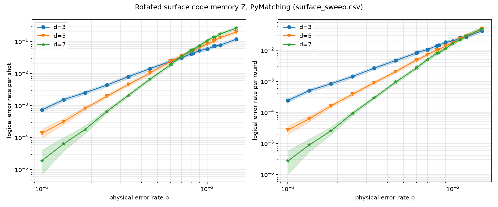
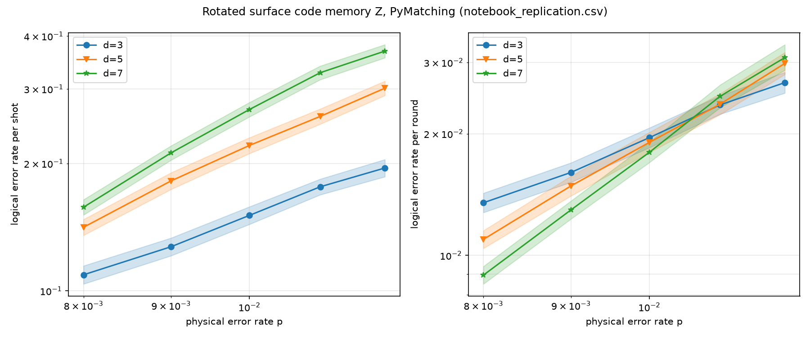

# qec-decoder-bench

A benchmark of quantum error-correction decoders, built on [Stim](https://github.com/quantumlib/Stim)
(circuits and detector error models), [PyMatching](https://github.com/oscarhiggott/PyMatching)
(minimum-weight perfect matching), BP-OSD from [`ldpc`](https://github.com/quantumgizmos/ldpc), and
sinter (parallel Monte Carlo).

Roadmap: rotated surface code with PyMatching (Phase 1, below), then BP-OSD, then the
[[144,12,12]] bivariate bicycle code.

## Usage

```bash
pip install -e ".[dev]"
pytest                      # all tests; `pytest -m "not slow"` skips Monte Carlo-heavy ones
python scripts/run_surface_sweep.py --sweep main          # -> results/surface_sweep.csv
python scripts/run_surface_sweep.py --sweep replication   # -> results/notebook_replication.csv
python scripts/plot_surface_sweep.py results/surface_sweep.csv
python scripts/plot_surface_sweep.py results/notebook_replication.csv
```

Both sweep CSVs are committed, so you can regenerate the plots and the validation numbers without
re-running the sweeps. sinter resumes from an existing CSV instead of starting over.

## Phase 1: rotated surface code memory experiment

**Setup.** `surface_code:rotated_memory_z` from Stim with uniform circuit-level depolarizing noise:
`after_clifford_depolarization`, `before_round_data_depolarization`,
`before_measure_flip_probability` and `after_reset_flip_probability` are all set to p. Decoding is
PyMatching via sinter, with d ∈ {3, 5, 7}.

**Reference.** Stim's [`doc/getting_started.ipynb`](https://github.com/quantumlib/Stim/blob/main/doc/getting_started.ipynb),
section 9, uses this same noise model with rounds = 3d and p ∈ {0.008, …, 0.012}. It plots the
logical error rate per round and gives the threshold as "roughly 1%".

**Pre-registered acceptance criterion** (fixed before any sweep ran): the per-round crossing
between the d=5 and d=7 curves must fall in **0.7%–1.1%**.

### Validation checks (tests)

| Check | Type | Result |
|---|---|---|
| p = 0 → no detection events, no logical errors (d=3, 5) | analytic limit | pass |
| `shortest_graphlike_error()` length = d (d=3, 5, 7) | known value | pass |
| p = 0.3 → p_L ≈ 1/2 (d=3, 20k shots, ±4σ) | analytic limit | pass (0.498) |
| p = 2e-3: p_L(d=5) < p_L(d=3), >3σ separated | below-threshold behaviour | pass (1.05e-3 vs 2.97e-3) |

Low-p slopes of log p_L vs log p (main sweep, p ≤ 0.004; reported only, not pass/fail) come out as
1.93, 2.94 and 4.07 for d = 3, 5, 7, against ⌈d/2⌉ = 2, 3, 4.

## Findings

### Threshold crossing: the main sweep missed the band; the notebook replication is inside it

| Sweep | Rounds | Errors / point | (5,7) per-round crossing | Bootstrap 95% interval | p where d=5, d=7 agree within 2σ | Criterion |
|---|---|---|---|---|---|---|
| main | d | ~1,000 | **1.30%** | [0.98%, 1.42%] (median 1.08%; no crossing in 5% of replicates) | 1.0, 1.1, 1.11, 1.2, 1.5% | **fail** |
| replication | 3d | ~5,000+ | **1.055%** | [1.025%, 1.103%] | 1.1, 1.2% | pass |

How the crossing is computed: interpolate log(p_L,7 / p_L,5) linearly in log p and take the first
sign change. The uncertainty comes from a parametric bootstrap, which redraws each point's error
count from Binomial(shots, errors/shots) 2,000 times and re-runs the same estimator.




(The shaded bands are sinter's likelihood-ratio intervals, which are wider than 2σ.)

**What the data shows:**

1. **With the notebook's settings, we reproduce its threshold.** The replication crossing, 1.055%
   [1.025%, 1.103%], is consistent with "roughly 1%".

2. **The main sweep's crossing is poorly determined, and its point estimate misses the band.**
   Between p = 1.0% and 1.5%, the d=5 and d=7 per-round curves are within 2σ of each other at
   almost every sampled p. With only ~1,000 errors per point (~±3%), the sign-change estimator
   jumps around: the point estimate is 1.30%, but the bootstrap median is 1.08%, and the 95%
   interval spans 0.98%–1.42%. Part of this fragility comes from the p grid itself. Merging the
   log-spaced and linear grids produced near-duplicate points (0.011 and 0.0111, 0.008 and
   0.00822), and neighbours only ~1% apart in p let noise create spurious sign changes. The
   criterion was set on the point estimate, so the main sweep fails it. That result stands.

3. **Per-round rates depend on the number of rounds, and the dependence differs by distance.**
   Comparing the same (d, p) between the two sweeps:

   | d | per-round p_L (rounds = d) / (rounds = 3d), p = 0.008–0.012 | z-scores |
   |---|---|---|
   | 3 | 1.01–1.13 (higher with fewer rounds) | −0.2 to −3.4 |
   | 5 | 0.92–1.00 | 0.0 to 2.3 |
   | 7 | 0.87–0.94 (lower with fewer rounds, all 5 points) | 1.6 to 4.2 |

   The per-round conversion, p_round = (1 − (1 − 2 p_shot)^(1/r)) / 2, assumes every round
   contributes the same, independent flip probability. Time boundaries break that assumption.
   The first round's detectors compare against deterministic resets, and the final round uses
   data-qubit measurements, so these rounds have a different error structure from bulk rounds.
   With r = d, the boundary makes up a larger fraction of the shot, so it biases the per-round
   rate. Because r grows with d in the main sweep, the bias also differs between distances.
   Around 1.0–1.2%, it makes d=7 look relatively better than d=5 than it does at r = 3d. That
   pushes the crossing up, in the same direction as the miss we observed.

**Conclusion.** The rounds-dependence of the per-round rate is real and statistically significant
(item 3), and it shifts the main sweep's crossing in the observed direction. **We have not shown
that it explains the full shift from ~1.06% to 1.30%.** The main sweep's crossing interval
[0.98%, 1.42%] contains the replication value, so statistical noise in a poorly resolved crossing
(item 2) remains a sufficient explanation on its own. The pre-registered band was not changed. The
main sweep failed it; the replication, with the reference's exact settings, passed.

**Next step to separate the two explanations:** re-sample the main sweep (rounds = d) at p ∈ {0.010, 0.011, 0.012} with
≥5,000 errors per point. If the crossing stays near 1.3% with a tight interval, the boundary effect
accounts for the shift; if it moves toward 1.05%, it was noise.
